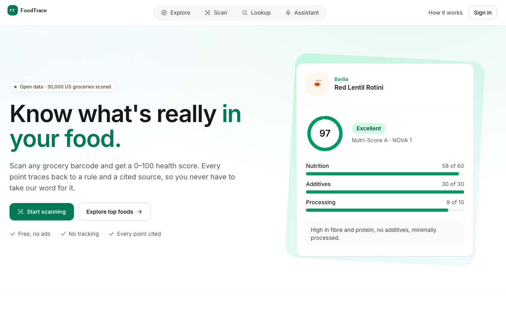
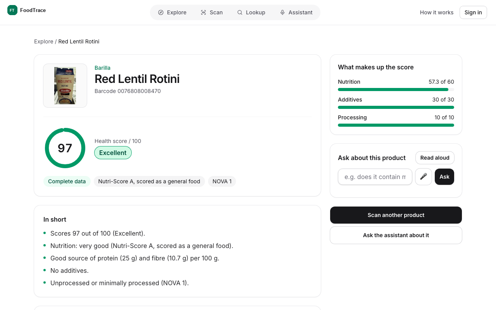
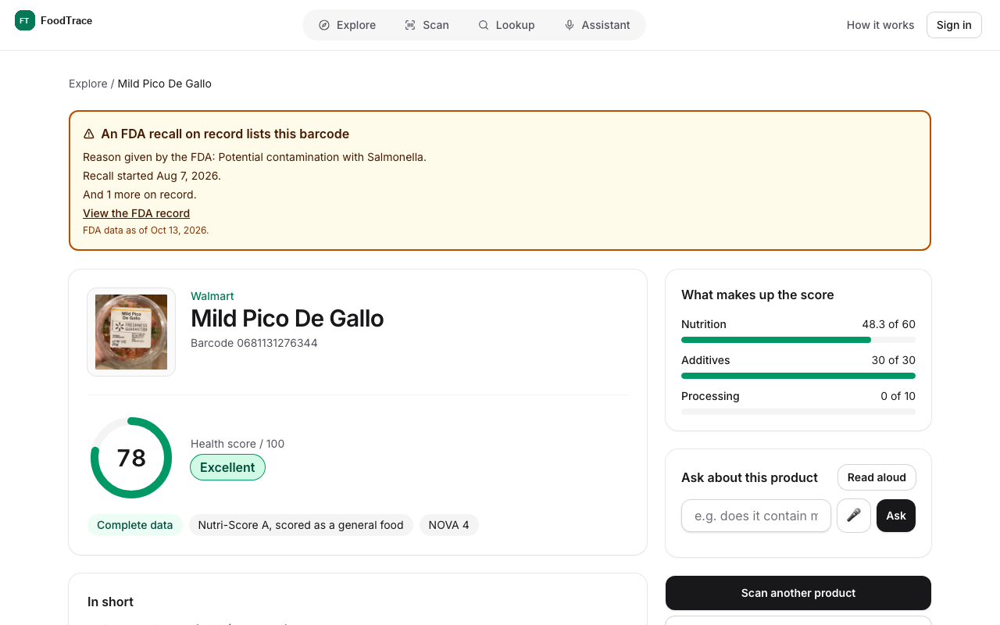
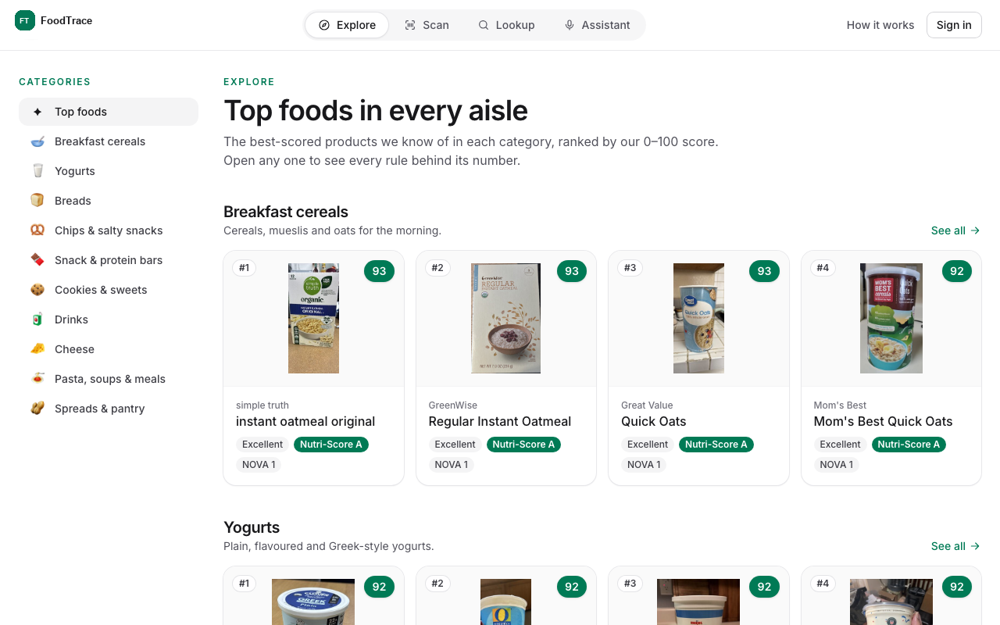
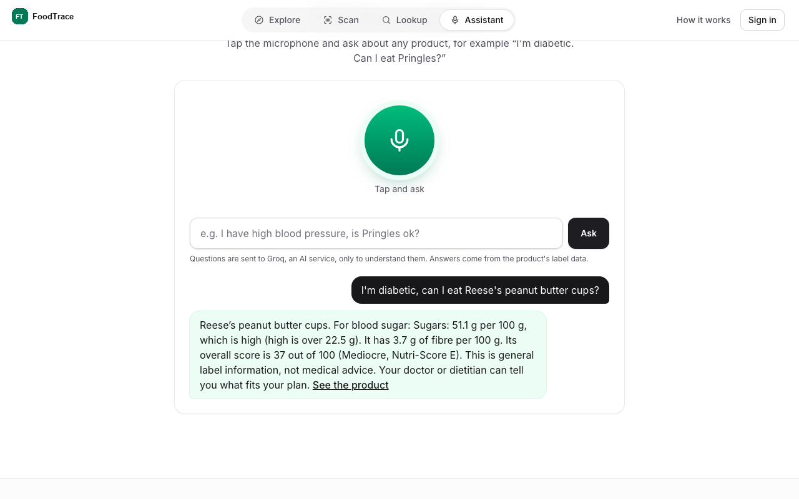
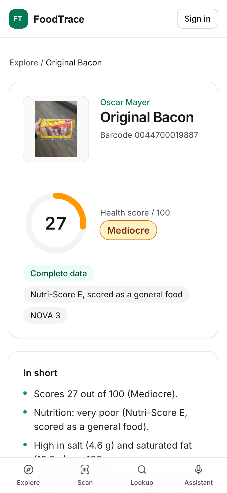
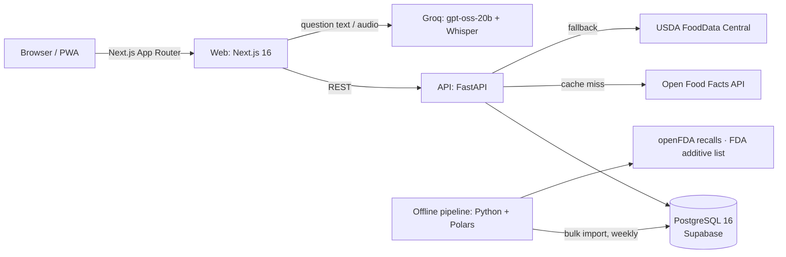

<div align="center">

# FoodTrace

**AI-Powered Grocery Intelligence Platform**

Scan a grocery barcode and get a 0–100 health score where every point has a source.

[](https://github.com/samarthshete/FoodTrace/actions/workflows/ci.yml)
[](https://github.com/samarthshete/FoodTrace/actions/workflows/codeql.yml)
[](LICENSE)
-orange)



</div>

---

FoodTrace is an AI-powered grocery intelligence platform for US groceries. Scan or search a
product and you get a score from 0 to 100, a plain-English summary, every rule that was
applied with a link to its source, FDA recall warnings, and better-scored alternatives from the
same aisle. A voice assistant answers questions like *"I'm diabetic, can I eat Pringles?"* from
the product's label data.

It's built on open data and open-source software and runs on **$0/month** of infrastructure.

## Highlights

| | |
| --- | --- |
| **Explainable scores** | Every point traces back to a rule and a cited source: Nutri-Score 2023, EFSA additive risk ratings, NOVA processing, FDA regulations. |
| **Deterministic** | The scoring engine is pure Python. The same inputs and engine version always give the same score. No AI is involved in scoring. |
| **Honest about gaps** | Missing data lowers the *confidence*, never the score. Values are never guessed; without the key inputs a product is "not scored". |
| **Safety first** | FDA recalls from openFDA are matched by barcode and shown as a banner, whatever the score. |
| **Voice assistant** | Ask by voice or text. Groq Whisper turns speech into text, a small open model works out the question, and the answer is a template over label data. |
| **Explore** | The best-scored products in ten categories, from breakfast cereals to snacks and drinks. |
| **Accounts** | Email and password or Google. Scan history, saved products, allergen and diet warnings, all deletable in one click. |
| **Accessible** | WCAG 2.1 AA, checked with axe in CI on the main pages. Works as an installable PWA. |

## Screenshots

<table>
  <tr>
    <td width="50%"><br><sub><b>Product page</b>: score, summary and the parts that make it up</sub></td>
    <td width="50%"><br><sub><b>FDA recall</b>: shown even when the food scores well</sub></td>
  </tr>
  <tr>
    <td width="50%"><br><sub><b>Explore</b>: top foods per category</sub></td>
    <td width="50%"><br><sub><b>Assistant</b>: "I'm diabetic, can I eat Reese's?"</sub></td>
  </tr>
</table>

<p align="center"><br><sub><b>Mobile</b>: bottom tab bar, like a native app</sub></p>

## How the score works

```
score = 60 × Nutrition  +  30 × Additives  +  10 × Processing        (0–100)
```

| Part | Weight | Based on |
| --- | --- | --- |
| **Nutrition** | 60 | The official **Nutri-Score 2023** algorithm, with separate rules for general foods, drinks, cheese, and fats, oils, nuts and seeds. The grade (A–E) sets the range. |
| **Additives** | 30 | Starts at full marks; only additives with an **EFSA** overexposure risk rating cost points. US regulatory status (GRAS, approved additive, CFR reference) is shown as fact. |
| **Processing** | 10 | The **NOVA** group, from 1 (unprocessed) to 4 (ultra-processed). |

**Caps:** a Nutri-Score of D or E caps the total at 49, so clean ingredients can't make poor
nutrition look good. High-risk additives cap it too.

**Bands:** Excellent ≥ 75 · Good ≥ 50 · Mediocre ≥ 25 · Poor < 25.

**Accuracy:** our Nutri-Score grades match Open Food Facts' own on **99.4%** of a 3,000-product
golden set of real US products, enforced in CI.

Weights and thresholds live in [`config/scoring.yaml`](config/scoring.yaml) and are versioned
(`engine_version`). The full method is on the app's *How the score works* page.

## Architecture



| Layer | Stack |
| --- | --- |
| Web | Next.js 16 (App Router), TypeScript, Tailwind, installable PWA |
| Barcode | `barcode-detector` (ZXing-C++ WASM, served locally, no CDN) |
| API | FastAPI, SQLAlchemy 2 (async), Alembic |
| Database | PostgreSQL 16: `pg_trgm`, full-text search, JSONB, row-level security |
| Pipeline | Python 3.12 + Polars: streams the Open Food Facts export and USDA data |
| Auth | Better Auth (email and password, Google) |
| Assistant | Groq free tier: `openai/gpt-oss-20b` to understand questions, `whisper-large-v3-turbo` for speech; keyword rules as fallback |
| CI | GitHub Actions: tests, lint, e2e, CodeQL, Dependabot, release-please |

## Getting started

**Requirements:** Python 3.12 with [`uv`](https://docs.astral.sh/uv/), Node 24 with `pnpm`
(via `corepack`), and PostgreSQL 16 (Docker locally, or a free Supabase project).

```bash
# 1. Configure
cp .env.example .env                    # set DATABASE_URL and OFF_CONTACT
cp web/.env.example web/.env.local      # auth secret, auth DB URL, optional Google and Groq keys

# 2. Database and data
docker compose up -d db                 # or point DATABASE_URL at Supabase
uv run alembic upgrade head
uv run python -m pipeline.reference     # additives + FDA status
uv run python -m pipeline.recalls       # openFDA recalls
uv run python -m pipeline.off_bulk      # US products from Open Food Facts (~1.3 GB download)

# 3. Run
uv run fastapi dev api/app/main.py      # API on :8000
cd web && corepack pnpm install && pnpm dev   # web on :3000
```

Optional: `scripts/warm-cache.sh` pre-loads popular products into the API's response cache.
For a free-tier deployment (Render + Vercel + Supabase), see [docs/DEPLOY.md](docs/DEPLOY.md).

## Testing

**576 automated tests**, plus 69 database integration tests and 11 browser tests that run in CI.

| Suite | Command | What it covers |
| --- | --- | --- |
| Python | `uv run pytest -q` | Scoring engine, Nutri-Score, additives, barcodes, search, explore, cache, pipeline (316 tests) |
| Golden set | `uv run pytest api/tests/golden -v` | ≥ 99% Nutri-Score agreement with Open Food Facts |
| Integration | runs in CI with Postgres | The API end to end against a real database |
| Web | `cd web && pnpm test` | Pages, components, assistant, auth (260 tests) |
| Browser | `cd web && pnpm e2e` | Real browser flows plus WCAG 2.1 AA checks with axe |
| Quality | `uv run ruff check . && uv run mypy api pipeline` · `pnpm lint && pnpm typecheck` | Lint and strict types |

## Spec-driven development

Behaviour is defined first, in [`specs/`](specs/README.md): **25 specs, 270 numbered
requirements** (for example `GTIN-3` or `ASSIST-19`). Every test is tagged with the requirements
it covers, and a traceability test fails CI if a requirement has no test or a test cites one that
doesn't exist.

## Principles

1. **Zero cost.** Free tiers and open data only; heavy work happens in the browser or the offline pipeline.
2. **No AI in the scoring.** Scores are deterministic and explanations are templates over the breakdown.
3. **Careful health language.** Never "toxic", "dangerous" or "unsafe". Regulatory status is stated as fact. Educational, not medical advice.
4. **Privacy.** No third-party analytics. Minimal data, row-level security, and one-click deletion.

## Data and attribution

- Product data from [Open Food Facts](https://world.openfoodfacts.org), under the [Open Database License (ODbL)](https://opendatacommons.org/licenses/odbl/1-0/)
- Nutrient gap-filling from [USDA FoodData Central](https://fdc.nal.usda.gov) (public domain)
- Recalls from [openFDA](https://open.fda.gov); additive status from the FDA's *Substances Added to Food* inventory
- Additive risk ratings from EFSA, via the Open Food Facts taxonomy

## License

Code: [MIT](LICENSE). Data: see attribution above.

> FoodTrace provides educational information, not medical advice. Talk to your doctor or
> dietitian about what fits your diet.
